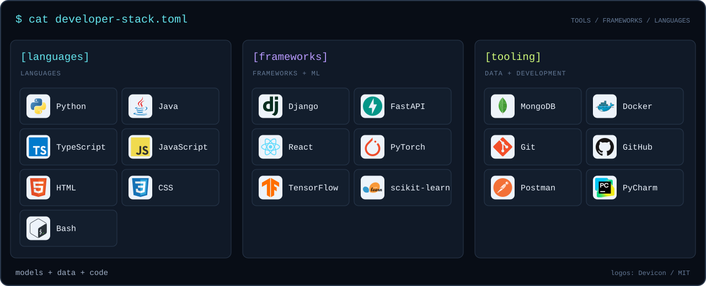
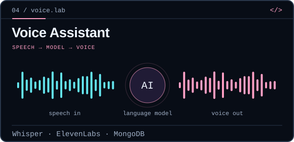

<picture><source media="(max-width: 620px)" srcset="./assets/neural-studio-mobile.svg"></picture>

<p align="center"><b>I connect models, context, and tools to build useful AI software.</b><br>LLM applications · Retrieval systems · AI agents · Voice interfaces</p>

<p align="center"><a href="#developer-stack">Stack</a> &nbsp; / &nbsp; <a href="#engineering-labs">Projects</a> &nbsp; / &nbsp; <a href="#engineering-focus">Engineering focus</a> &nbsp; / &nbsp; <a href="mailto:fawad.khan.ai.developer@gmail.com">Contact</a></p>

## Developer stack

<picture><source media="(max-width: 620px)" srcset="./assets/developer-stack-mobile.svg"></picture>

```toml
[generative_ai]
models        = ["OpenAI", "Gemini", "Groq", "Ollama"]
orchestration = ["LangChain", "LangGraph"]
retrieval     = ["FAISS", "ChromaDB"]
```

<details>
<summary><b>Read the stack as text</b></summary>

- **Languages:** Python, Java, TypeScript, JavaScript, HTML, CSS, Bash.
- **Frameworks & ML:** Django, FastAPI, React, PyTorch, TensorFlow, scikit-learn.
- **Data & development:** MongoDB, Docker, Git, GitHub, Postman, PyCharm.

</details>

## Engineering labs

My work spans document AI, agent workflows, local language models, voice, computer vision, and multilingual NLP. Each animated panel illustrates its project's workflow; open it to inspect the code.

<table>
<tr><td width="50%" valign="top"><a href="https://github.com/MFAI-Developer/Teachify--AI-Powered-Lecture-Generation-From-Text-SaaS-"></a><br><a href="https://github.com/MFAI-Developer/Teachify--AI-Powered-Lecture-Generation-From-Text-SaaS-"><b>Teachify → source code</b></a><br><sub>Retrieval-backed lecture generation from prompts and documents, with narration, visuals, and avatar integration.</sub></td><td width="50%" valign="top"><a href="https://github.com/MFAI-Developer/genai-crm-assistant"></a><br><a href="https://github.com/MFAI-Developer/genai-crm-assistant"><b>GenAI CRM Assistant → source code</b></a><br><sub>HubSpot contact and deal workflows with plan–validate–execute orchestration.</sub></td></tr>
<tr><td width="50%" valign="top"><a href="https://github.com/MFAI-Developer/E-Commerce-Customer-Support-Bot"></a><br><a href="https://github.com/MFAI-Developer/E-Commerce-Customer-Support-Bot"><b>Local AI Support Bot → source code</b></a><br><sub>Self-hosted support with local language models, vector retrieval, and session memory.</sub></td><td width="50%" valign="top"><a href="https://github.com/MFAI-Developer/Toy-Chatbot"></a><br><a href="https://github.com/MFAI-Developer/Toy-Chatbot"><b>Voice Assistant → source code</b></a><br><sub>Speech recognition, generated voice responses, retrieval, and persistent conversation history.</sub></td></tr>
<tr><td width="50%" valign="top"><a href="https://github.com/MFAI-Developer/Bangla-Data-Extraction"></a><br><a href="https://github.com/MFAI-Developer/Bangla-Data-Extraction"><b>Bangla Data Extraction → source code</b></a><br><sub>Structured information extraction from Bangla text and documents through an API.</sub></td><td width="50%" valign="top"><a href="https://github.com/MFAI-Developer/Cancer-detection-in-images"></a><br><a href="https://github.com/MFAI-Developer/Cancer-detection-in-images"><b>Image Classification Lab → source code</b></a><br><sub>Configurable vision models, transfer learning, training metrics, and inference endpoints.</sub></td></tr>
</table>

<details>
<summary><b>More code — document Q&A, speech, multilingual NLP, and async APIs</b></summary>
<br>

- **[Loan document Q&A](https://github.com/MFAI-Developer/Loan-Bot)** — OpenAI, LangChain, FAISS, and Streamlit, with source-page display.
- **[Gemini voice chatbot](https://github.com/MFAI-Developer/AudioBot-gemini)** — speech input, model responses, and text-to-speech.
- **[Code-switching & language detection](https://github.com/MFAI-Developer/Code-Switching-and-Language-detection)** — TensorFlow BiLSTM sequence labeling.
- **[Asynchronous weather API](https://github.com/MFAI-Developer/Asynchronous-Weather-API-Calls)** — asynchronous HTTP requests with FastAPI and HTTPX.

</details>

## Engineering focus

- **Context → answers:** document retrieval and vector search for language-model applications.
- **Intent → action:** model orchestration connected to business APIs and tools.
- **Models → interfaces:** Python APIs, web applications, and voice conversations.

## Connect

```python
open_to = ["AI engineering roles", "project work", "technical collaboration"]
```

**[fawad.khan.ai.developer@gmail.com](mailto:fawad.khan.ai.developer@gmail.com)**

<p align="center"><sub>Build with context. Ship with code.</sub></p>

<sub>Custom diagrams and animations are authored in SVG. Technology logos: <a href="https://github.com/devicons/devicon">Devicon</a> · <a href="./assets/DEVICON-LICENSE.txt">MIT license</a>.</sub>
