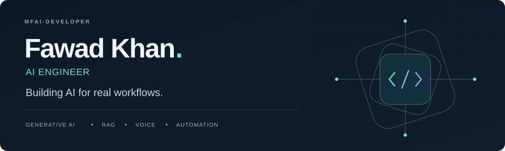

<picture>
  <source media="(prefers-color-scheme: dark)" srcset="./assets/profile-hero-dark.svg">
  <source media="(prefers-color-scheme: light)" srcset="./assets/profile-hero-light.svg">
  
</picture>

  <a href="#selected-work">Explore my work</a> &nbsp; · &nbsp;
  <a href="mailto:fawad.khan.ai.developer@gmail.com">Get in touch</a> &nbsp; · &nbsp;
  <a href="https://github.com/MFAI-Developer?tab=repositories">All repositories</a>

## Turning models into useful applications

I'm **Fawad Khan**, an **AI Engineer** building LLM applications, retrieval systems, and automation tools. I connect models with documents, voice, and business workflows through Python APIs and web interfaces.

My projects span CRM assistants, local customer support, AI lecture generation, multilingual document extraction, and deep learning.

### What I build

- **AI assistants & automation** — natural language interfaces for CRM operations and business workflows.
- **RAG & document intelligence** — retrieval pipelines that connect language models with relevant source material.
- **Voice & multimodal applications** — speech interfaces and tools that combine generated text, audio, and visuals.
- **Applied machine learning** — image classification and token-level language detection experiments.

## Selected work

<table>
<tr>
<td width="50%" valign="top">
<h3><a href="https://github.com/MFAI-Developer/Teachify--AI-Powered-Lecture-Generation-From-Text-SaaS-">Teachify</a></h3>

<strong>From source material to educational content.</strong>

Lecture generation from prompts and documents, with retrieval, narration, visuals, and Azure avatar integration.

Gemini · FAISS · FastAPI · React · TypeScript

</td>
<td width="50%" valign="top">
<h3><a href="https://github.com/MFAI-Developer/genai-crm-assistant">GenAI CRM Assistant</a></h3>

<strong>Natural language to business actions.</strong>

A plan–validate–execute workflow for HubSpot contacts and deals, with optional email confirmations.

LangGraph · FastAPI · HubSpot · OpenAI

</td>
</tr>
<tr>
<td width="50%" valign="top">
<h3><a href="https://github.com/MFAI-Developer/E-Commerce-Customer-Support-Bot">Local AI Support Bot</a></h3>

<strong>Support answers from your own knowledge base.</strong>

A self-hosted RAG demo using local language models, vector search, a chat interface, and session memory.

Ollama · ChromaDB · LangChain · Docker · Streamlit

</td>
<td width="50%" valign="top">
<h3><a href="https://github.com/MFAI-Developer/Bangla-Data-Extraction">Bangla Document Intelligence</a></h3>

<strong>Documents into structured information.</strong>

API-based extraction of names, contact details, links, and other fields from Bangla text and documents.

Groq · Llama · FastAPI · PyMuPDF

</td>
</tr>
<tr>
<td width="50%" valign="top">
<h3><a href="https://github.com/MFAI-Developer/Toy-Chatbot">Conversational Voice Assistant</a></h3>

<strong>Speech, conversation, and persistent history.</strong>

A chatbot API combining speech recognition, generated voice responses, retrieval, and MongoDB chat storage.

Whisper · ElevenLabs · Groq · FastAPI · MongoDB

</td>
<td width="50%" valign="top">
<h3><a href="https://github.com/MFAI-Developer/Cancer-detection-in-images">Image Classification Lab</a></h3>

<strong>Explore, train, and evaluate vision models.</strong>

A skin-lesion classification project with configurable CNNs, transfer learning, training metrics, and inference endpoints.

PyTorch · torchvision · scikit-learn · FastAPI

</td>
</tr>
</table>

**More to explore:** [Document Q&A](https://github.com/MFAI-Developer/Loan-Bot) · [Gemini Voice Bot](https://github.com/MFAI-Developer/AudioBot-gemini) · [Code-Switching & Language Detection](https://github.com/MFAI-Developer/Code-Switching-and-Language-detection) · [Async Weather API](https://github.com/MFAI-Developer/Asynchronous-Weather-API-Calls)

## Tools I work with

| Area | Technologies |
| :--- | :--- |
| **LLMs & orchestration** | OpenAI, Gemini, Groq, Ollama, LangChain, LangGraph |
| **Retrieval & data** | FAISS, ChromaDB, Sentence Transformers, MongoDB, PyMuPDF |
| **APIs & interfaces** | Python, FastAPI, Pydantic, Streamlit, React, TypeScript |
| **ML & voice** | PyTorch, TensorFlow, scikit-learn, Whisper, ElevenLabs |
| **Application delivery** | Docker, Docker Compose, Git |

## Let's build something useful

Have an AI engineering role, a product idea, or an open-source project in mind? I'd be glad to connect about **LLM applications, RAG, voice interfaces, and workflow automation**.

**[fawad.khan.ai.developer@gmail.com](mailto:fawad.khan.ai.developer@gmail.com)**
