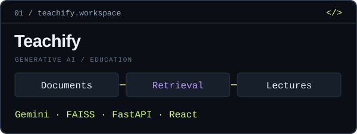
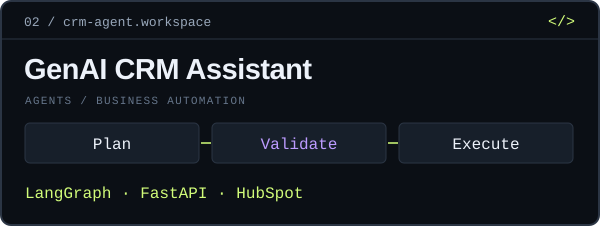
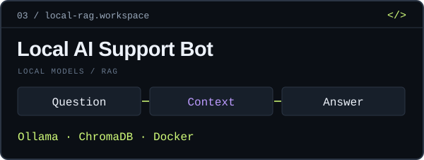
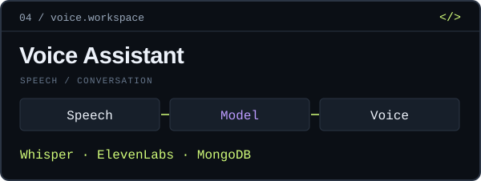
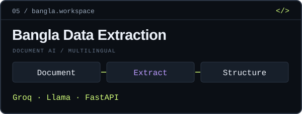
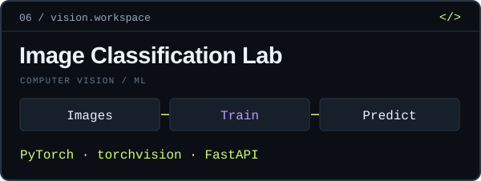
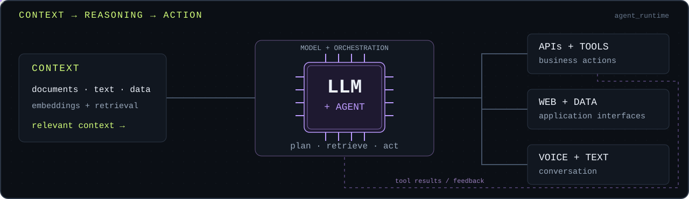

<picture><source media="(max-width: 620px)" srcset="./assets/workbench-hero-mobile.svg"></picture>

<p align="center"><b>I turn models, documents, APIs, and voice into useful AI software.</b><br>LLM applications · Retrieval systems · Agent workflows · Voice interfaces</p>

<p align="center"><a href="#developer-stack">Developer stack</a> &nbsp; / &nbsp; <a href="#project-workspaces">Explore the code</a> &nbsp; / &nbsp; <a href="mailto:fawad.khan.ai.developer@gmail.com">Get in touch</a></p>

## Developer stack

<table>
<tr>
<td width="33%" align="center" valign="top"><b>01 / LANGUAGES</b><br><br><br><br><sub>Python · Java · TypeScript<br>JavaScript · HTML · CSS · Bash</sub></td>
<td width="34%" align="center" valign="top"><b>02 / FRAMEWORKS + ML</b><br><br><br><br><sub>Django · FastAPI · React<br>PyTorch · TensorFlow · scikit-learn</sub></td>
<td width="33%" align="center" valign="top"><b>03 / DATA + DEVELOPMENT</b><br><br><br><br><sub>MongoDB · Docker · Git<br>GitHub · Postman · PyCharm</sub></td>
</tr>
</table>

**Models & inference** &nbsp; `OpenAI` `Gemini` `Groq` `Ollama`<br>
**Agents & retrieval** &nbsp; `LangChain` `LangGraph` `FAISS` `ChromaDB`

## Project workspaces

My projects connect AI with real documents, business workflows, voice, and web applications—with additional work in computer vision and multilingual NLP. Open a workspace to explore its source.

<table>
<tr><td width="50%" valign="top"><a href="https://github.com/MFAI-Developer/Teachify--AI-Powered-Lecture-Generation-From-Text-SaaS-"></a><br><a href="https://github.com/MFAI-Developer/Teachify--AI-Powered-Lecture-Generation-From-Text-SaaS-"><b>Teachify → source code</b></a></td><td width="50%" valign="top"><a href="https://github.com/MFAI-Developer/genai-crm-assistant"></a><br><a href="https://github.com/MFAI-Developer/genai-crm-assistant"><b>GenAI CRM Assistant → source code</b></a></td></tr>
<tr><td width="50%" valign="top"><a href="https://github.com/MFAI-Developer/E-Commerce-Customer-Support-Bot"></a><br><a href="https://github.com/MFAI-Developer/E-Commerce-Customer-Support-Bot"><b>Local AI Support Bot → source code</b></a></td><td width="50%" valign="top"><a href="https://github.com/MFAI-Developer/Toy-Chatbot"></a><br><a href="https://github.com/MFAI-Developer/Toy-Chatbot"><b>Voice Assistant → source code</b></a></td></tr>
<tr><td width="50%" valign="top"><a href="https://github.com/MFAI-Developer/Bangla-Data-Extraction"></a><br><a href="https://github.com/MFAI-Developer/Bangla-Data-Extraction"><b>Bangla Data Extraction → source code</b></a></td><td width="50%" valign="top"><a href="https://github.com/MFAI-Developer/Cancer-detection-in-images"></a><br><a href="https://github.com/MFAI-Developer/Cancer-detection-in-images"><b>Image Classification Lab → source code</b></a></td></tr>
</table>

<details>
<summary><b>More from the workspace — document Q&A, voice, NLP, and async APIs</b></summary>
<br>

- **[Loan document Q&A](https://github.com/MFAI-Developer/Loan-Bot)** — OpenAI, LangChain, FAISS, and Streamlit, with source-page display.
- **[Gemini voice chatbot](https://github.com/MFAI-Developer/AudioBot-gemini)** — speech input, model responses, and text-to-speech.
- **[Code-switching & language detection](https://github.com/MFAI-Developer/Code-Switching-and-Language-detection)** — TensorFlow BiLSTM sequence labeling.
- **[Asynchronous weather API](https://github.com/MFAI-Developer/Asynchronous-Weather-API-Calls)** — asynchronous HTTP requests with FastAPI and HTTPX.

</details>

## System architecture

Context, orchestration, tools, and interfaces are the connections I work on when building AI applications.

<picture><source media="(max-width: 620px)" srcset="./assets/agent-runtime-mobile.svg"></picture>

## Connect

```python
open_to = ["AI engineering roles", "project work", "technical collaboration"]
```

**[fawad.khan.ai.developer@gmail.com](mailto:fawad.khan.ai.developer@gmail.com)**

<p align="center"><sub>Context in. Useful software out.</sub></p>
