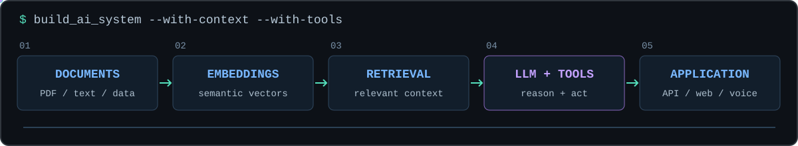

<p align="center"></p>

<p align="center"><b>Language models. Real data. Useful software.</b><br>LLM applications · RAG · AI agents · Voice AI · Automation</p>

<p align="center"><a href="#selected-projects">Projects</a> &nbsp; / &nbsp; <a href="#languages-and-tools">Tech stack</a> &nbsp; / &nbsp; <a href="mailto:fawad.khan.ai.developer@gmail.com">Contact</a></p>

## About me

```python
fawad = {
    "role": "AI Engineer",
    "languages": ["Python", "Java", "TypeScript", "JavaScript"],
    "backend": ["Django", "FastAPI"],
    "frontend": ["React"],
    "focus": ["LLM apps", "RAG", "AI agents", "Voice AI"],
}
```

I connect language models with **documents, business APIs, voice, and web interfaces**. My work spans AI assistants and automation, with additional projects in computer vision and multilingual NLP.

## Languages and tools

**Languages**

<p><br><sub>Python · Java · TypeScript · JavaScript · HTML · CSS · Bash</sub></p>

**Frameworks & machine learning**

<p><br><sub>Django · FastAPI · React · PyTorch · TensorFlow · scikit-learn</sub></p>

**Data & development**

<p><br><sub>MongoDB · Docker · Git · GitHub · Postman · PyCharm</sub></p>

| AI stack | Tools |
| :--- | :--- |
| Models & inference | `OpenAI` · `Gemini` · `Groq` · `Ollama` |
| Agents & orchestration | `LangChain` · `LangGraph` |
| Retrieval & vector search | `FAISS` · `ChromaDB` |

## Selected projects

| Project | Engineering highlights |
| :--- | :--- |
| **[Teachify](https://github.com/MFAI-Developer/Teachify--AI-Powered-Lecture-Generation-From-Text-SaaS-)**<br><sub>Gemini · FAISS · FastAPI · React</sub> | **Documents → lectures.** Retrieval-backed lecture generation with narration, visuals, and avatar integration. |
| **[GenAI CRM Assistant](https://github.com/MFAI-Developer/genai-crm-assistant)**<br><sub>LangGraph · FastAPI · HubSpot</sub> | **Language → business actions.** Plan–validate–execute orchestration for HubSpot contacts and deals. |
| **[Local AI Support Bot](https://github.com/MFAI-Developer/E-Commerce-Customer-Support-Bot)**<br><sub>Ollama · ChromaDB · Docker</sub> | **Local models → grounded answers.** Self-hosted customer support with vector retrieval and session memory. |
| **[Bangla Data Extraction](https://github.com/MFAI-Developer/Bangla-Data-Extraction)**<br><sub>Groq · Llama · FastAPI</sub> | **Documents → structured information.** Extracts information from Bangla text and documents through an API. |
| **[Conversational Voice Assistant](https://github.com/MFAI-Developer/Toy-Chatbot)**<br><sub>Whisper · ElevenLabs · MongoDB</sub> | **Speech → conversation.** Speech recognition, generated voice responses, retrieval, and persistent chat history. |
| **[Image Classification Lab](https://github.com/MFAI-Developer/Cancer-detection-in-images)**<br><sub>PyTorch · torchvision · FastAPI</sub> | **Images → predictions.** Configurable vision models, transfer learning, training metrics, and inference endpoints. |

<details>
<summary><b>More code to explore — document Q&A, voice, NLP, and async APIs</b></summary>
<br>

- [Loan document Q&A](https://github.com/MFAI-Developer/Loan-Bot) — OpenAI, LangChain, FAISS, and Streamlit, with source-page display.
- [Gemini voice chatbot](https://github.com/MFAI-Developer/AudioBot-gemini) — speech input, model responses, and text-to-speech.
- [Code-switching & language detection](https://github.com/MFAI-Developer/Code-Switching-and-Language-detection) — TensorFlow BiLSTM sequence labeling.
- [Asynchronous weather API](https://github.com/MFAI-Developer/Asynchronous-Weather-API-Calls) — asynchronous HTTP requests with FastAPI and HTTPX.

</details>

## From context to application



## Let's connect

For **AI engineering roles, project work, and technical collaborations** around LLM applications, RAG, AI agents, or voice interfaces:

**[fawad.khan.ai.developer@gmail.com](mailto:fawad.khan.ai.developer@gmail.com)**

<p align="center"><sub>Build with context. Connect with code.</sub></p>
